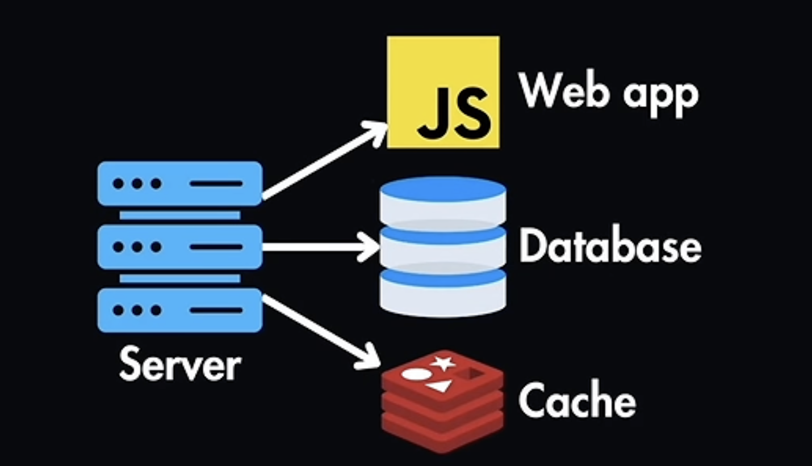
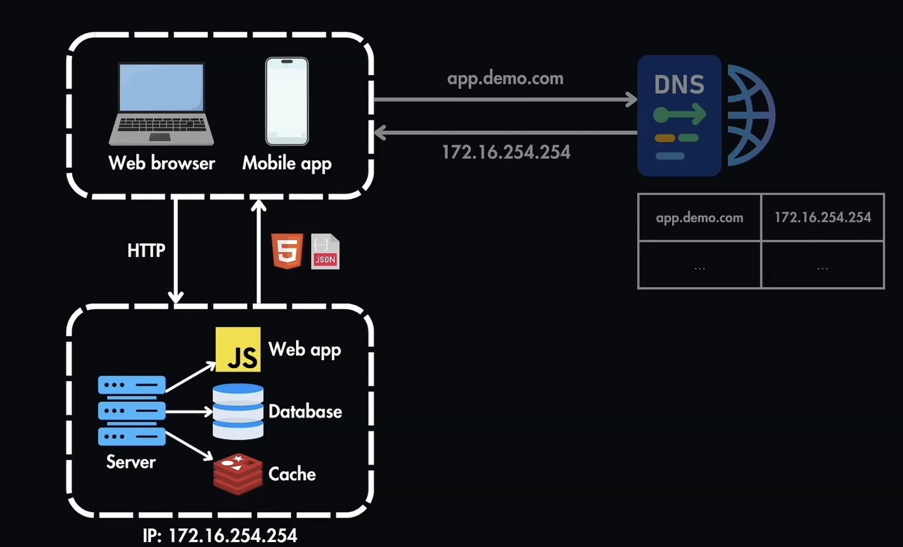
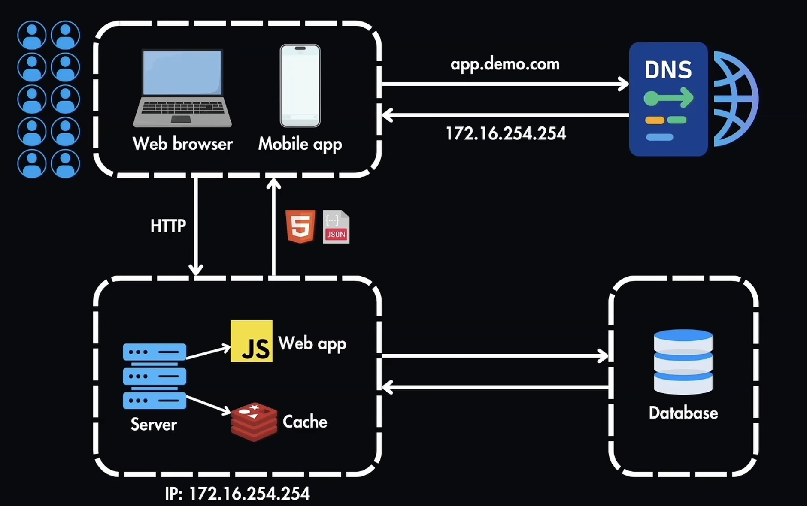

# System Design

### Roadmap
1- Foudations 

2- API Design

3- Databases

4- Caching

5- Big Data

6- Production Infra

#### Building a single server setup

#### Understanding Request Flow

- Initialy mobile app or web browser don't have the IP address its trying to reach it only has a domain name 
- The web browser contact the DNS (Domain Name Service) that maps domain to IP Adrress and returns it to web browser
- The web browser sends an HTTP request to server requesting specific data
- the server proccesses the request and sends back data
- the response could be HTML or JSON format

Ex: GET /product/:id : this retrieves details for product ID = 456

{
    "productID": 456, 
    "name": "Wireless headphones",
    "descreption": "Noise cancelling headphones"
    "price": 149.99
}

### Databases

- as number of users grow it isnt enough to handle the demand
- to accomodate for that we split the web tier and data tier

##### How do we chose our database

Two Main Options
- Relational Databases: RDMS (relational database management system) ex: postgreSQL, MySQL
- Non Relational Databases: NoSQL ex: MongoDB

#### Relational Databases
- Uses structred query language (SQL) for finding and manipulating data
- The data is sructured in tables (colomns and rows)
- Colomns: the attributes of the table
- rows: single records inside the table

CREATE TABLE costumers (
    id INTEGER PRIMARY KEY, 
    name VARCHAR(100)
    age INTEGER,
    email VARCHAR(100)
)

INSERT INTO costumers (id, name, age, integer)
VALUES (123, "Perla", 24, perlaha@gmail.com)

#### Advantages of relational databases

- support complex joined operations across multiple databases ex: joining the costumer table with products table
- data consistency and integrity specialy during transactions

Transaction: a sequence of one or more SQL operations that are performed as one atomic unit

All transactions in SQL follow ACID
- Automicy: completly succeful or completly fails
- Consistency: one valid form --> another valid form
- Isolation: isolated from other tranactions
- Durability: data remains if system fails

### NoSQL Database

No SQL databse can come in different forms:
- document store: is stored in JSON documents which allows it to haave complex data in a single record like mongoDB
- wide-common stores: data is stored in colomns, rows, and dynamic coloumns like Casandra
- Graph database: stores data and their relationships as graph ex: amazon use neptune graph to recomnd products based in your recent search history
- Key-Value Stores: main advantage is simplicity and speed as they are primarly stored in the RAM for things like caching

#### Relational databases vs Non-Relational databses

|Relational Databases|Non-Relational Databases|
|--------------------|------------------------|
| data is well-structred | unstructred or semi structred data|
|string consistency and transactional integrity| low latency and rapid response
|Ex: Banking system| scalable storage for masive data volumes|

